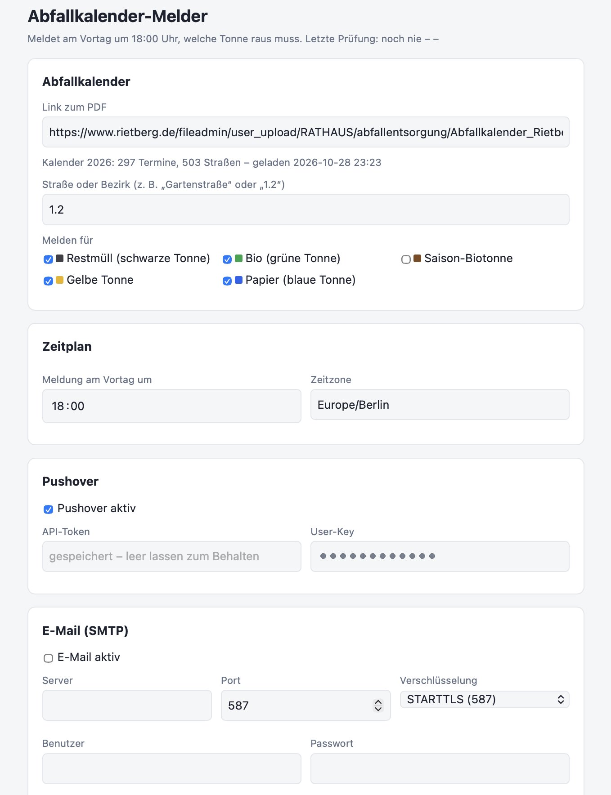
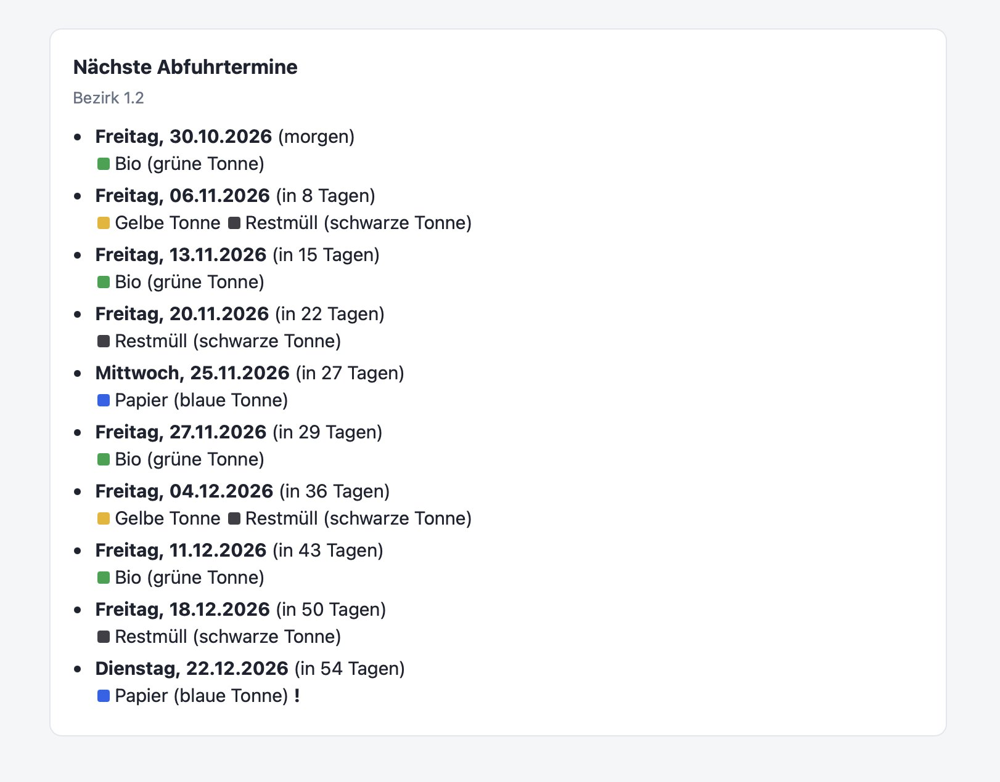

# Abfallkalender-Melder

Liest den [Abfallkalender der Stadt Rietberg](https://www.rietberg.de/rathaus/abfallentsorgung) direkt aus dem PDF und meldet **am Vortag zur eingestellten Uhrzeit** (Standard: 18:00), welche Tonne raus muss – per **Pushover** und/oder **E-Mail (SMTP)**.
Alles wird über die Weboberfläche eingestellt (Port **8643**): PDF-Link, Straße bzw. Bezirk (z. B. „Gartenstraße“ → 1.2), gewünschte Tonnen, Uhrzeit, Versandkanal.
Einstellungen, ausgelesener Kalender und Status liegen in `/data` (`config.json`, `kalender.json`, `status.json`).

<p>
  
  
</p>

## ZimaOS

1. **App Store → Benutzerdefinierte App installieren → Import** und den Inhalt von
   [`zimaos-compose.yml`](zimaos-compose.yml) einfügen.
2. Weboberfläche öffnen: `http://<zima-ip>:8643` → Straße/Bezirk & Kanal wählen → Speichern → „Testnachricht senden“.

Das Image `ghcr.io/vdite/abfallkalender-melder` wird per GitHub Actions für amd64 und arm64 gebaut.

## Normales Docker

```bash
docker compose up -d --build
```
Oder ohne Bauen: `docker run -d -p 8643:8080 -v ./data:/data ghcr.io/vdite/abfallkalender-melder:latest`. Dann `http://localhost:8643` öffnen.

## Funktionsweise

- Das PDF wird beim Speichern eines neuen Links und danach wöchentlich neu geladen (falls die Stadt nachbessert). Schlägt das fehl, bleibt der zuletzt gelesene Stand aktiv.
- Die Tonnenart steht im PDF nur als Farbkästchen neben der Bezirksnummer; die App ordnet die Farben Restmüll, Bio, Saison-Bio, Gelbe Tonne und Papier zu.
- Restmüll/Bio gelten für Hauptbezirke (`1+3`, `2+4`), Gelbe Tonne/Papier für Unterbezirke (`1.2`, `2.2+3.2` …) – aus Bezirk 1.2 folgt also beides automatisch.
- Täglich zur Meldezeit wird geprüft, ob **morgen** etwas abgeholt wird; jede Abfuhr wird **einmal** gemeldet. War der Container zur Meldezeit aus, wird am selben Tag nachgeholt.
- Verschobene Termine (im PDF mit „!“ markiert, z. B. nach Feiertagen) sind in der Meldung gekennzeichnet.
- Zwei Wochen vor dem letzten Termin kommt einmalig eine Erinnerung, den Link zum Kalender des Folgejahres einzutragen.
- Unter `http://<zima-ip>:8643/liste` gibt es nur die Terminliste, ohne Einstellungen (z. B. für ein Tablet an der Wand; lädt sich alle 30 Minuten neu). Anzahl per `?anzahl=5`.
- Die Weboberfläche hat keinen Login – nur im Heimnetz betreiben, nicht ins Internet freigeben.

Testlauf ohne Versand: `python app/abfallkalender.py --trocken --datum 2026-10-29`
